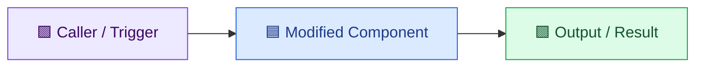

## What and why
<!-- What this PR changes and the reason for it. Link the issue if there is one. -->

## ⚡ Visual Delta (Fast Inspection)
<!--
Run `python scripts/visual-diff.py` to auto-generate this Mermaid diagram for staged changes,
or paste your custom flow delta using the docs/ARCHITECTURE.md palette:
-->

## Verification
- [ ] `python scripts/verify.py` passes (any skipped checks are listed below)
- [ ] Behavior changes come with a new or updated test
- [ ] Commits follow the conventions in `AGENTS.md`
- [ ] Visual delta diagram inspected (`python scripts/visual-diff.py --open`)

## Notes for review
<!-- Anything risky, follow-ups, or skipped checks. -->
