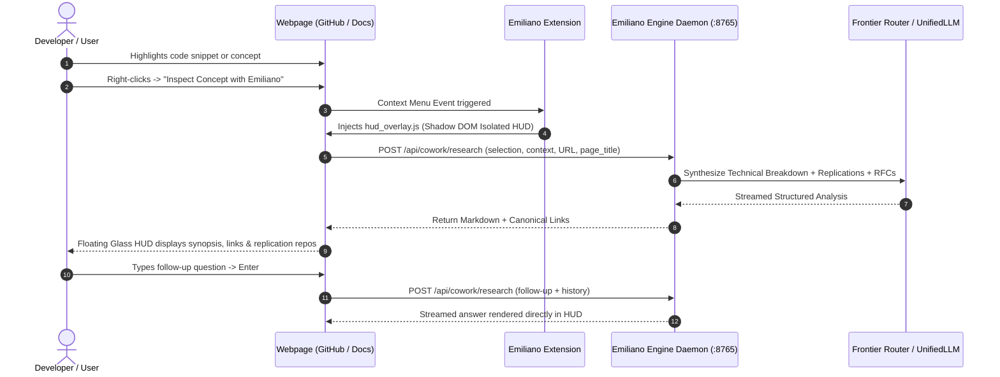

# Emiliano Cowork Companion (Chrome & Firefox Extension)

> Autonomous background browser automation bridge & **Deep Concept / Code Inspector** for the **Emiliano Desktop Cowork Platform**.
> Enables deterministic DOM scripting, virtual keyboard input, background navigation, and instant contextual technical research across **Google Chrome** and **Mozilla Firefox**.

---

## ⚡ Highlights & Key Capabilities

1. **Cross-Browser Universal Support**:
   * Works on **Google Chrome** (Blink / Manifest V3 Service Worker).
   * Works on **Mozilla Firefox** (Gecko / Manifest V3 Background Scripts).
   * Auto-connects to the local Emiliano daemon (`ws://127.0.0.1:8765/ws/browser`).

2. **🔍 Deep Concept & Code Research Lens ("Highlight & Inspect")**:
   * Highlight any code snippet, API method, architectural pattern, or technical term on **any website** (GitHub, StackOverflow, documentation, papers, blogs).
   * Right-click and choose:
     * **"🔍 Inspect Concept with Emiliano"**
     * **"🧬 Find Deep Links & Replications"**
     * **"⚡ Explain Code & Architecture"**
   * An encapsulated, dark glassmorphism **Shadow DOM HUD** slides in seamlessly beside your text.
   * Delivers **executive synopsis**, **internal mechanics**, **canonical documentation & RFC links**, **GitHub replication repositories**, and **production gotchas**.
   * Includes interactive follow-up Q&A and a 1-click **Copy Analysis** button.

3. **Silent Background Automation**:
   * Virtual DOM typing (`execCommand('insertText')`) and element dispatch without moving the hardware cursor.
   * Zero window focus stealing (`WM_ACTIVATE` immunity) — work in your IDE while Emiliano operates in background tabs.
   * High-resolution off-screen PNG receipt captures.

---

## 🚀 15-Second Installation & Loading

### 1. Build the Extension Directories
From `emiliano/apps/browser-extension`:
```bash
node build.js
```
This generates:
* `dist/chrome`: Ready-to-load unpacked Chrome extension.
* `dist/firefox`: Ready-to-load unpacked Firefox add-on.

---

### 2. Loading into Google Chrome
1. Open Chrome and navigate to:
   ```text
   chrome://extensions
   ```
2. Enable **Developer mode** in the top-right corner.
3. Click **Load unpacked** in the top-left corner.
4. Select the directory:
   ```text
   C:\Users\artlu\OracliomNew\Oracliom\emiliano\apps\browser-extension\dist\chrome
   ```
   *(or the root `emiliano/apps/browser-extension` folder)*
5. The extension badge will show **`ON`** (green) as soon as the Emiliano engine is running.

---

### 3. Loading into Mozilla Firefox
1. Open Firefox and navigate to:
   ```text
   about:debugging#/runtime/this-firefox
   ```
2. In the "Temporary Extensions" section, click **Load Temporary Add-on...**
3. Select the file:
   ```text
   C:\Users\artlu\OracliomNew\Oracliom\emiliano\apps\browser-extension\dist\firefox\manifest.json
   ```
4. Done! The extension icon appears in the toolbar, connects to `127.0.0.1:8765`, and enables all right-click context menu inspection features.

---

## 🔬 How the Concept & Code Inspector Works



---

## 🛠️ Supported Automation Actions (Engine RPC)

| Action | Parameters | Description |
| :--- | :--- | :--- |
| `navigate` | `{ url, targetUrlMatch, background }` | Navigates existing matching tab or opens a silent background tab. |
| `type_into` | `{ selector, text, targetUrlMatch }` | Types into inputs or React `contenteditable`. |
| `click_element` | `{ selector, targetUrlMatch }` | Scrolls to and clicks an element matching the CSS selector. |
| `click_by_text` | `{ text, tag, targetUrlMatch }` | Clicks an element containing specific text. |
| `capture_screenshot` | `{ targetUrlMatch }` | Captures a high-resolution PNG receipt of the tab. |
| `cdp_command` | `{ method, params, targetUrlMatch }` | Sends Chrome DevTools Protocol commands (Chromium only). |
| `get_tabs` | `{ query }` | Lists all active and background tabs. |
| `start_recording` | `{ goal }` | Starts Teach-a-Task DOM demonstration recording. |
| `stop_recording` | `{}` | Stops recording and returns captured DOM events. |

---

## 🔄 Hot-Reloading

* **Chrome**: Visit `chrome://extensions` and click the circular **Reload** icon on the Emiliano card.
* **Firefox**: Visit `about:debugging#/runtime/this-firefox` and click **Reload** under the Emiliano Temporary Add-on.
