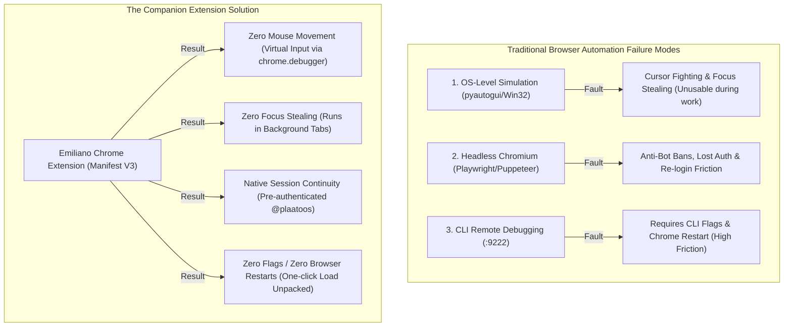

# Emiliano Cowork Companion (Chrome Extension)

> Autonomous background browser automation bridge for the **Emiliano Desktop Cowork Platform**.
> Enables deterministic DOM scripting, virtual keyboard input, page navigation, and receipt capture **without moving the physical mouse cursor or stealing window focus**.

---

## 🧠 Why a Browser Extension is Needed (The Technical Rationale)

In desktop AI agent engineering, automating authenticated web applications (Instagram, LinkedIn, CRM dashboards, internal portals) has traditionally suffered from a fatal compromise: **either you hijack the human user's screen, or you get blocked by anti-bot defenses.**

Understanding why an in-browser companion extension is architecturally necessary requires analyzing the failure modes of traditional approaches:



### 1. The Single Hardware Cursor Contention
The Windows OS kernel (`win32k.sys`) maintains **exactly one hardware mouse cursor device context** across all monitors and virtual desktops.
* When an external Python agent calls `pyautogui.moveTo(x, y)` or `user32.mouse_event()`, it takes physical control of that single pointer.
* If the user is actively working (coding in VS Code, editing a document, or browsing), the cursor gets jerked across the display.
* If the user moves their mouse at the same millisecond the agent clicks, the click lands at corrupted coordinates ("cursor tug-of-war").

### 2. Focus Annihilation (`WM_ACTIVATE` / `AttachThreadInput`)
To send keystrokes into a browser window, Win32 input simulation requires bringing that window to the absolute top of the Z-order (`SetForegroundWindow`).
* This shifts the OS keyboard input queue (`WM_SETFOCUS`) to Chrome.
* Keystrokes typed by the human operator into their IDE or Slack during that turn are either lost or accidentally typed into Chrome's input boxes.
* **Result:** The user cannot do any foreground work while the agent is running.

### 3. The Headless Anti-Bot Trap
Running a headless browser instance (`playwright --headless`) completely isolates the agent, but creates three fatal operational barriers:
* **Session Amnesia:** Headless browsers start with clean storage. Users must manually export session tokens or repeatedly solve two-factor authentication (SMS/MFA) inside automated windows.
* **Aggressive Fingerprinting:** Modern platforms (Meta Botguard, Cloudflare Turnstile, Datadome) inspect WebGL vendor strings, canvas hashes, and `navigator.webdriver`. Headless Chromium instances are flagged and restricted within minutes.
* **Zero Observability:** When an action fails, the user cannot easily observe or intervene in the browser tab.

### 4. The Command-Line Flag Friction (`--remote-debugging-port=9222`)
Speaking directly to Chrome over the Chrome DevTools Protocol (CDP) allows virtual input without moving the mouse. However:
* Chromium explicitly ignores `--remote-debugging-port` if an existing Chrome process is already running without that flag.
* To use it, the user must terminate all their active Chrome windows and restart Chrome from a custom shortcut or command prompt.

---

### The Solution: The In-Browser Companion Architecture

A **Chrome Extension (Manifest V3)** operates inside Chrome's internal privileged architecture. This provides the ultimate "sweet spot" for desktop cowork:

| Feature | 1. OS Simulation (`pyautogui`) | 2. Headless Playwright | 3. CDP Flag (`:9222`) | 4. Emiliano Chrome Extension [OUR APPROACH] |
| :--- | :--- | :--- | :--- | :--- |
| **User Foreground Multitasking** | ❌ Blocked (Must wait) | ✅ Uninterrupted | ✅ Uninterrupted | ✅ **100% Uninterrupted** |
| **Physical Mouse Cursor** | ❌ Hijacked / Jitters | ✅ Stationary | ✅ Stationary | ✅ **Stationary (Zero movement)** |
| **Active OS Keyboard Focus** | ❌ Stolen (`WM_ACTIVATE`) | ✅ Untouched | ✅ Untouched | ✅ **Untouched (Background tabs)** |
| **Pre-authenticated Sessions** | ✅ Available | ❌ Requires re-login | ✅ Available | ✅ **Instant Access (Pre-logged in)** |
| **Anti-Bot Trust Score** | High (Human input) | ❌ Low (Headless flags) | High | ✅ **Maximum (Authentic browser)** |
| **Requires Browser Restart?** | ✅ No | ✅ No | ❌ Yes (Needs CLI flag) | ✅ **No (Works on existing Chrome)** |
| **Installation Friction** | None | High | Medium | âś… **15-second "Load Unpacked"** |

#### Privileged Capabilities Granted to the Extension:
1. **`chrome.debugger` API:** Chromium allows an extension with the `"debugger"` permission to attach to any tab's internal DevTools Protocol *without launching Chrome with command-line flags*. It sends virtual keystrokes (`Input.dispatchKeyEvent`) directly to the Blink rendering engine.
2. **`chrome.scripting` API:** Directly interacts with React and Lexical contenteditable editors via `document.execCommand('insertText')`, dispatching native DOM mutation events without requiring active window focus.
3. **`chrome.tabs` API:** Manages silent background tabs, navigates URLs, and captures off-screen PNG receipts without popping windows over the user's workspace.

---

## 🚀 15-Second Installation (Developer Mode / Unpacked)

You do **not** need to install this from the Chrome Web Store, pay developer fees, or wait for reviews. It runs locally as an unpacked extension.

1. Open **Google Chrome** and navigate to:
   ```text
   chrome://extensions
   ```
2. In the top-right corner, toggle **Developer mode** to **ON**.
3. In the top-left corner, click **Load unpacked**.
4. Select this directory:
   ```text
   C:\Users\artlu\OracliomNew\Oracliom\emiliano\apps\browser-extension
   ```
5. **Done!** The extension icon will appear in your Chrome toolbar. The badge will show `ON` (green) as soon as the Emiliano engine daemon (`127.0.0.1:8765`) is active.

---

## ⚡ Architecture Flow

```
┌───────────────────────────────────────┐
│     Emiliano Engine Daemon (Python)   │
│          ws://127.0.0.1:8765          │
└──────────────────┬────────────────────┘
                   │ Local WebSocket (/ws/browser)
                   â–Ľ
┌───────────────────────────────────────┐
│  Emiliano Chrome Companion Extension  │
│          (Manifest V3 Worker)         │
└──────────────────┬────────────────────┘
                   │ Internal Chromium APIs (chrome.debugger, chrome.scripting)
                   â–Ľ
┌────────────────────────────────────────────────────────┐
│ Target Webpage (Instagram, LinkedIn, CRM, etc.)        │
│ • Virtual DOM injection (React/Lexical compatible)     │
│ • Deterministic background tab navigation              │
│ • Off-screen receipt screenshot capture                │
│ • Zero OS mouse cursor movements                       │
│ • Zero window focus stealing                           │
└────────────────────────────────────────────────────────┘
```

---

## 🛠️ Supported Automation Actions

The extension exposes high-level RPC commands over WebSocket:

| Action | Parameters | Description |
| :--- | :--- | :--- |
| `navigate` | `{ url, targetUrlMatch, background }` | Navigates existing matching tab or opens a silent background tab. |
| `type_into` | `{ selector, text, targetUrlMatch }` | Types into inputs or React `contenteditable` (via `execCommand('insertText')`). |
| `click_element` | `{ selector, targetUrlMatch }` | Scrolls to and clicks an element matching the CSS selector. |
| `click_by_text` | `{ text, tag, targetUrlMatch }` | Clicks an element containing specific text. |
| `capture_screenshot` | `{ targetUrlMatch }` | Captures a high-resolution PNG receipt of the tab. |
| `cdp_command` | `{ method, params, targetUrlMatch }` | Sends raw Chrome DevTools Protocol commands via `chrome.debugger`. |
| `get_tabs` | `{ query }` | Lists all active and background tabs. |

---

## 🔄 Hot-Reloading

When modifying any JavaScript file in this extension:
1. Go to `chrome://extensions`.
2. Click the circular **Reload** icon on the **Emiliano Cowork Companion** card.
3. The new code takes effect immediately without restarting Chrome!
