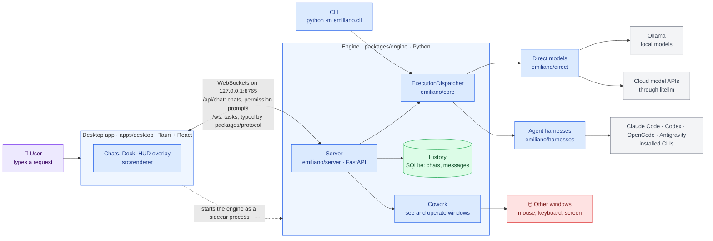
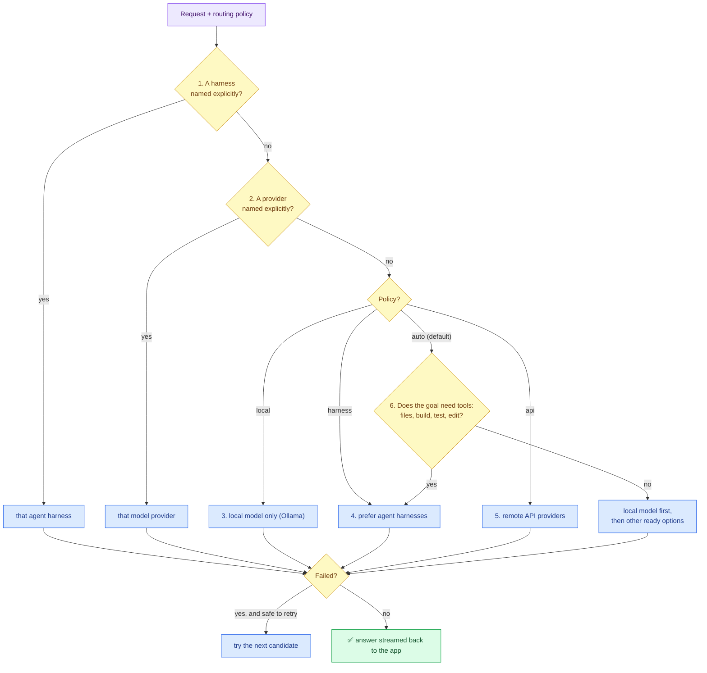
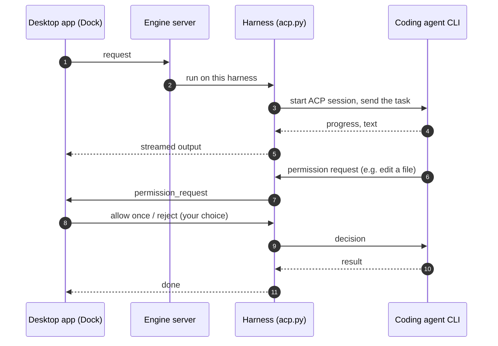
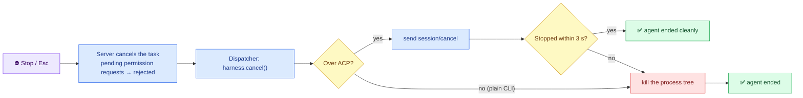
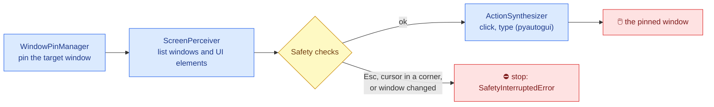

# Architecture

The map of Emiliano: what its parts are, how a request becomes work done by a model or a coding agent, and
where to change what. Keep it current: a change that adds, removes or rewires a part updates the diagram in
the same pull request (`AGENTS.md`, section 11).

## Color palette

| Color | Meaning |
| :--- | :--- |
| 🟦 Blue | Our code: engine, desktop app, protocol |
| 🟪 Purple | Inputs: the user's request, configuration |
| 🟨 Yellow | Decisions and safety checks |
| 🟩 Green | Outputs and stored results |
| ⬜ Grey | External programs and services we do not own |
| 🟥 Red | Risky: API keys, control of the mouse and keyboard |

## The big picture

Emiliano is a desktop assistant that sends each request to the best place to run it: a local model, a cloud
model, or a coding agent (Claude Code, Codex, OpenCode, Antigravity). It can also see and operate other windows
("Cowork").

**Local only.** The server accepts only `127.0.0.1` / `localhost` hosts (`TrustedHostMiddleware`) and only the
desktop app's origins (`emiliano/server/security.py`). API keys are managed by `CredentialManager`
(`emiliano/direct/credentials.py`) and never logged unredacted.

## How a request is routed

`ExecutionDispatcher` (`emiliano/core/dispatcher.py`) checks these in order and uses the first that applies:

Only usable candidates count: a provider without credentials, or a harness whose CLI is not installed, is skipped.
A failure is not retried elsewhere when that could repeat work, for example after an agent already changed files.

## How a coding agent runs

Claude Code and Codex run over the **Agent Client Protocol** (ACP) when their ACP adapter is installed
(`claude-agent-acp`, `codex-acp`); OpenCode does when `opencode_acp_cmd: "opencode acp"` is set. Emiliano starts
the agent's ACP command and talks to it in structured messages (JSON-RPC over stdin/stdout). When the agent asks
to use a tool, the request is relayed over the chat WebSocket (`/api/chat`) to the Dock, and **you approve or
reject it**. No answer within 120 s counts as a rejection. Agents without ACP run as a plain CLI process whose
text output is streamed (`BaseHarness.run_task`); they get the `--dangerously-*` flags unless
`unattended_fallback: false`. Why ACP: [ADR 0001](adr/0001-use-acp-for-harnesses.md).

**Stopping.** Stop in the Dock (or Esc anywhere while a task runs) cancels the task, and the dispatcher then
calls `harness.cancel()` so the agent process stops too, not only the chat. Cancelling the wait alone would leave
the agent running in its worker thread.

## Cowork: operating other windows

HTTP endpoints: `GET /api/cowork/windows`, `POST /api/cowork/pin`, `/unpin`, `GET /api/cowork/elements`,
`POST /api/cowork/click`, `/type`. **Esc must always stop it**: never weaken the emergency stop.

## Parts

| Part | Folder | What it does | Talks to |
| :--- | :--- | :--- | :--- |
| Desktop app | `apps/desktop` | Tauri 2 + React UI: chats, Dock (permission prompts), HUD overlay. Starts the bundled engine (sidecar); set `EMILIANO_EXTERNAL_ENGINE=1` to use one you started | Engine server |
| Protocol | `packages/protocol` | Message schemas shared by both sides: `models.py` (Python) and `types.ts` (TypeScript) | — |
| Server | `packages/engine/emiliano/server` | FastAPI on port 8765: `/health`, `/api/models`, cowork endpoints, WebSocket `/ws`; chat history at `/api/chats` and WebSocket `/api/chat` | Dispatcher, history, cowork |
| Dispatcher and registry | `packages/engine/emiliano/core` | Routing policy, capability registry, configuration, workspace and context | Direct, harnesses |
| Direct models | `packages/engine/emiliano/direct` | Unified client (litellm), Ollama manager, credentials | Ollama, cloud APIs |
| Harnesses | `packages/engine/emiliano/harnesses` | One adapter per coding agent; ACP client (`acp.py`); stopping a running agent (`cancel()`) | Agent CLIs |
| History | `packages/engine/emiliano/history` | SQLite store and API for chats and messages | Server |
| Cowork | `packages/engine/emiliano/cowork` | Window pinning, screen perception, mouse and keyboard actions | Other windows |
| CLI | `packages/engine/emiliano/cli.py` | Run requests, list harnesses, diagnostics, without the desktop app | Dispatcher |

## Where to change what

| To change... | Look in | Skill |
| :--- | :--- | :--- |
| Support another coding agent | `emiliano/harnesses/base.py` (+ `acp.py` if it speaks ACP) | `.agents/skills/add-harness-adapter` |
| A message between the app and the engine | `packages/protocol` (both files), then both sides | `.agents/skills/change-protocol` |
| How requests are routed | `emiliano/core/dispatcher.py` | `.agents/skills/review-change` |
| Cowork actions or their safety | `emiliano/cowork/` | `.agents/skills/review-change` |
| Chat history | `emiliano/history/` | `.agents/skills/review-change` |
