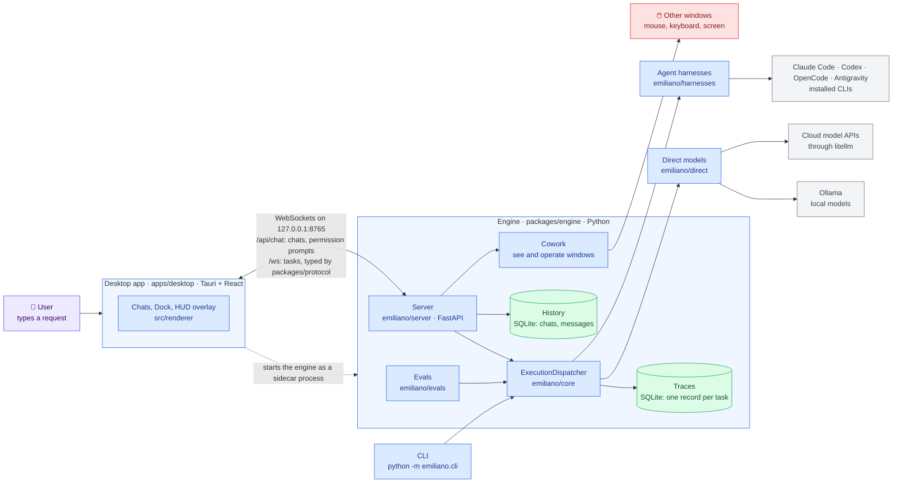
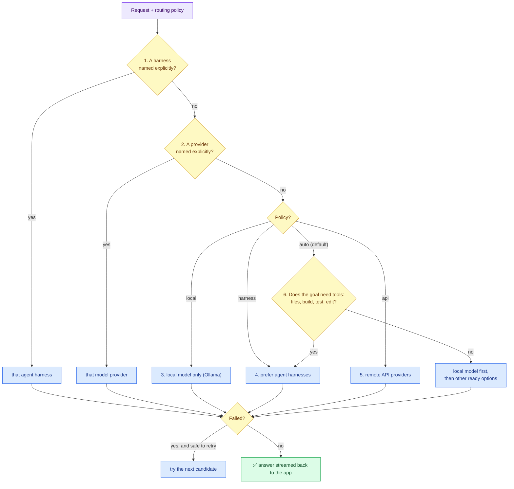
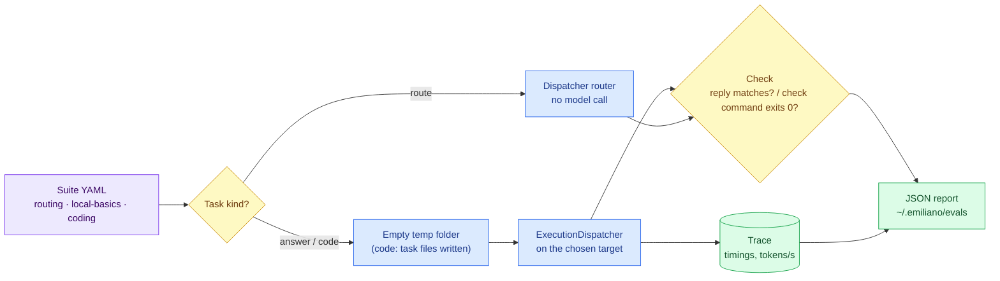
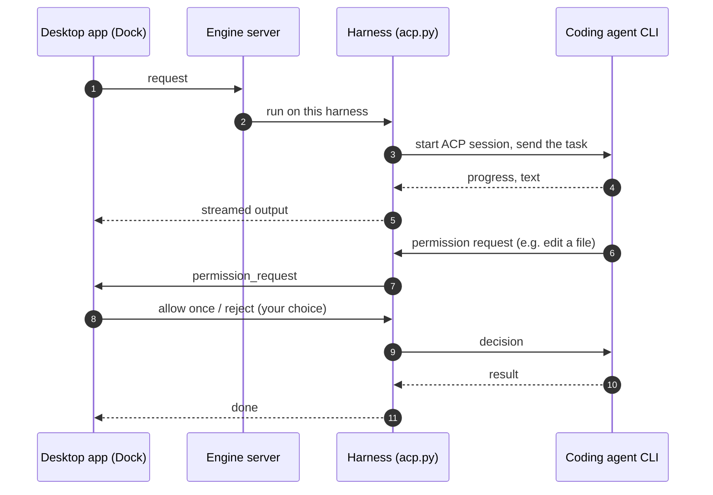
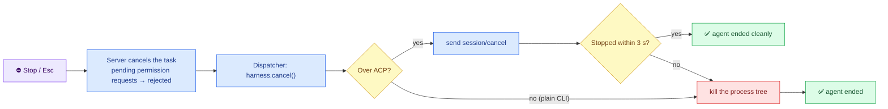
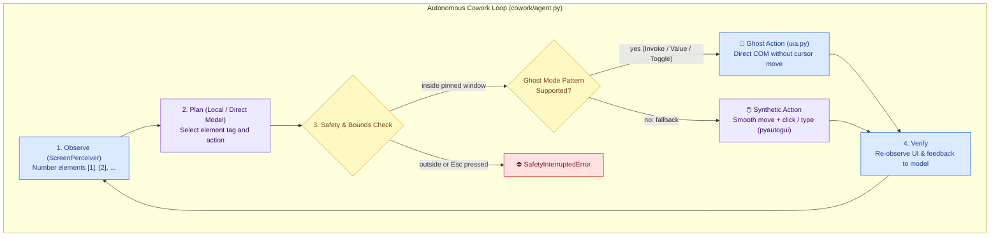

# Architecture

The map of Emiliano: what its parts are, how a request becomes work done by a model or a coding agent, and
where to change what. Keep it current: a change that adds, removes or rewires a part updates the diagram in
the same pull request (`AGENTS.md`, section 11).

## Color palette

| Color | Meaning |
| :--- | :--- |
| 🟦 Blue | Our code: engine, desktop app, protocol |
| 🟪 Purple | Inputs: the user's request, configuration |
| 🟨 Yellow | Decisions and safety checks |
| 🟩 Green | Outputs and stored results |
| ⬜ Grey | External programs and services we do not own |
| 🟥 Red | Risky: API keys, control of the mouse and keyboard |

## The big picture

Emiliano is a desktop assistant that sends each request to the best place to run it: a local model, a cloud
model, or a coding agent (Claude Code, Codex, OpenCode, Antigravity). It can also see and operate other windows
("Cowork").

**Local only.** The server accepts only `127.0.0.1` / `localhost` hosts (`TrustedHostMiddleware`) and only the
desktop app's origins (`emiliano/server/security.py`). API keys are managed by `CredentialManager`
(`emiliano/direct/credentials.py`) and never logged unredacted.

## How a request is routed

`ExecutionDispatcher` (`emiliano/core/dispatcher.py`) checks these in order and uses the first that applies:

**Step 6, does the goal need tools?** `core/routing.py` decides with rules (instant, offline, English and
Spanish): the goal names a file or path; points at the user's own work ("this code", "mis cambios"); gives a
command about a specific thing of theirs ("install the dependencies", "ejecuta los tests"); asks why something of
theirs is broken ("why is the build failing?"); or asks whether "this"/"it" compiles or runs. How-to questions
stay direct. Measured with `emiliano eval routing` (goals the rules were written against: 46/46) and
`emiliano eval routing-unseen` (goals written afterwards and never used for tuning: 17/28; the old keyword
router: 13/28). Rules miss commands without a familiar noun ("Show me the diff", "Sube los cambios"); a
local-model fallback for undecided goals is the next step.

Only usable candidates count: a provider without credentials, or a harness whose CLI is not installed, is skipped.
A failure is not retried elsewhere when that could repeat work, for example after an agent already changed files.

**Local models.** Every Ollama call asks for a context window of `models.ollama_num_ctx` tokens (default 8192), and
context management fits the conversation into that same number. Without it Ollama uses its small server default and
silently drops the start of longer prompts. Token counting uses the `cl100k_base` encoding bundled with litellm,
located without importing litellm (an import takes ~15 s), so it works offline.

**Ollama is called directly.** `UnifiedLLMClient` streams from Ollama's `/api/chat` over httpx; only remote
providers go through litellm, whose import takes ~13 s. Local requests never import it.

**Cold start.** A cold first local reply used to wait for discovery (each agent CLI's `--version`, ~10 s), the
litellm import (~13 s) and Ollama loading the model (16–29 s, depending on the disk), one after another. Now:

- Local calls skip litellm (above).
- A request that cannot use an agent (a forced provider, or the `local`/`api` policy) skips the agent CLI checks.
- The model is loaded ahead of time: by the engine at startup (`warm_up()`), by `emiliano chat` while the user
  types, and by `emiliano run` while it routes. Ollama loads it in its own process, so this overlaps cleanly. The
  litellm import is never overlapped with other work in a process: in a thread it holds the GIL, and it slowed
  concurrent discovery from 9 s to 44 s.

| Where | First output, cold model (measured) |
| :--- | :--- |
| Engine server (desktop app), after its startup warm-up | ~40 s → 1.3 s |
| `emiliano chat`, after 25 s of typing | ~45 s → 2.2 s |
| `emiliano run` (whole command, fresh process) | ~45–60 s → 14–19 s (mostly the model load) |

The model preloaded is the one discovery selects (or `--model`), with the same `num_ctx`, so the real call does not
load it again. `models.preload_local_model: false` turns preloading off.

## Measuring: traces and evals

A **trace** is one record per task, written by the dispatcher to `~/.emiliano/traces.db` (`core/traces.py`): which
route answered, which ones failed before it, the outcome, time to first output, duration, token counts reported by
the provider (Ollama is asked to include them) and tokens per second, and how permission requests were answered.
It never leaves the machine; `traces: false` turns it off, and `emiliano traces` lists recent ones.

An **eval** is a fixed task with an automatic check (`emiliano/evals`, run with `emiliano eval`). Suites are YAML
files in `evals/suites/`. Each task runs in an empty temporary folder, so a project's `CLAUDE.md` never leaks in.

A target is `ollama`, `ollama:<model>`, `<provider>:<model>` or a harness name (`claude_code`, `codex`, ...). Code
tasks are skipped for direct models, which cannot edit files yet. Coding agents run with no approval UI here, so
their permission requests are approved automatically inside the temporary folder.

## How a coding agent runs

Claude Code and Codex run over the **Agent Client Protocol** (ACP) when their ACP adapter is installed
(`claude-agent-acp`, `codex-acp`); OpenCode does when `opencode_acp_cmd: "opencode acp"` is set. Emiliano starts
the agent's ACP command and talks to it in structured messages (JSON-RPC over stdin/stdout). When the agent asks
to use a tool, the request is relayed over the chat WebSocket (`/api/chat`) to the Dock, and **you approve or
reject it**. No answer within 120 s counts as a rejection. Agents without ACP run as a plain CLI process whose
text output is streamed (`BaseHarness.run_task`); they get the `--dangerously-*` flags unless
`unattended_fallback: false`. Why ACP: [ADR 0001](adr/0001-use-acp-for-harnesses.md).

**Stopping.** Stop in the Dock (or Esc anywhere while a task runs) cancels the task, and the dispatcher then
calls `harness.cancel()` so the agent process stops too, not only the chat. Cancelling the wait alone would leave
the agent running in its worker thread.

## Cowork: operating other windows

**Reading the screen & Set-of-Marks grounding.** `ScreenPerceiver` reads a window's controls through Windows **UI Automation**
(`cowork/uia.py`, via `comtypes`): name, control type, automation ID and bounds, fetched in one call. It sees
inside browsers, Electron apps (VS Code), WPF and WinUI, which the older Win32 child-window method cannot (the
taskbar: 19 elements vs 4; VS Code: 199 vs 2). Actionable elements receive stable numeric tags (`[1] Button "Settings"`, `[2] TextInput "Search"`) with computed center coordinates.

**Ghost Actions vs. Synthetic Fallback.** When an action is taken on an element, `ActionSynthesizer` uses **Ghost Mode**:
it queries COM patterns (`IUIAutomationInvokePattern`, `IUIAutomationValuePattern`, `IUIAutomationTogglePattern`) directly
through the dedicated UIA worker thread. Ghost actions invoke controls and set edit box values directly in the application's
message queue without moving the user's mouse cursor across the screen. If the target control does not implement UIA patterns,
it cleanly falls back to smooth cursor movements and synthetic events via `pyautogui`.

**Autonomous Cowork Loop.** `CoworkAgentLoop` runs an Observe-Plan-Act-Verify cycle on a pinned window. The model plans actions
using numeric tags (`<call:click_element id="1"/>`, `<call:type_into_element id="2" text="..."/>`), the engine executes the action,
re-observes the window's UI tree to verify the outcome, and provides feedback until completion.

HTTP endpoints: `GET /api/cowork/windows`, `POST /api/cowork/pin`, `/unpin`, `GET /api/cowork/elements`,
`POST /api/cowork/click`, `POST /api/cowork/type`, `POST /api/cowork/run`. **Esc must always stop it**: never weaken the emergency stop.

## Parts

| Part | Folder | What it does | Talks to |
| :--- | :--- | :--- | :--- |
| Desktop app | `apps/desktop` | Tauri 2 + React UI: chats, Dock (permission prompts), HUD overlay. Starts the bundled engine (sidecar); set `EMILIANO_EXTERNAL_ENGINE=1` to use one you started | Engine server |
| Protocol | `packages/protocol` | Message schemas shared by both sides: `models.py` (Python) and `types.ts` (TypeScript) | — |
| Server | `packages/engine/emiliano/server` | FastAPI on port 8765: `/health`, `/api/models` (plus `/api/models/recommendations` rating local models for this GPU/RAM, and `POST /api/models/load` / `/unload`), cowork endpoints, WebSocket `/ws`; chat history at `/api/chats` and WebSocket `/api/chat` | Dispatcher, history, cowork |
| Dispatcher and registry | `packages/engine/emiliano/core` | Routing policy, capability registry, configuration, workspace and context | Direct, harnesses |
| Direct models | `packages/engine/emiliano/direct` | Unified client (Ollama directly, cloud APIs through litellm), DirectAgentLoop (file tools, ReAct loop), Ollama manager, credentials | Ollama, cloud APIs, workspace |
| Harnesses | `packages/engine/emiliano/harnesses` | One adapter per coding agent; ACP client (`acp.py`); stopping a running agent (`cancel()`) | Agent CLIs |
| History | `packages/engine/emiliano/history` | SQLite store and API for chats and messages | Server |
| Traces | `packages/engine/emiliano/core/traces.py` | One local record per task: route, fallbacks, timings, tokens/s, permission decisions | Dispatcher |
| Evals | `packages/engine/emiliano/evals` | Fixed tasks with automatic checks, run against a model or harness (`emiliano eval`) | Dispatcher |
| Cowork | `packages/engine/emiliano/cowork` | Window pinning, screen perception (UI Automation in `uia.py`, Win32 fallback), mouse and keyboard actions | Other windows |
| CLI | `packages/engine/emiliano/cli.py` | Run requests, list harnesses, diagnostics, without the desktop app | Dispatcher |

## Where to change what

| To change... | Look in | Skill |
| :--- | :--- | :--- |
| Support another coding agent | `emiliano/harnesses/base.py` (+ `acp.py` if it speaks ACP) | `.agents/skills/add-harness-adapter` |
| A message between the app and the engine | `packages/protocol` (both files), then both sides | `.agents/skills/change-protocol` |
| How requests are routed | `emiliano/core/dispatcher.py` | `.agents/skills/review-change` |
| Cowork actions or their safety | `emiliano/cowork/` | `.agents/skills/review-change` |
| Chat history | `emiliano/history/` | `.agents/skills/review-change` |
| Eval tasks or suites | `emiliano/evals/suites/*.yaml` (runner: `evals/runner.py`) | `.agents/skills/review-change` |
