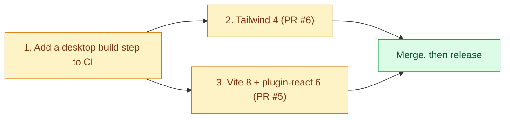

# Pending dependency upgrades

Dependabot opened these upgrades and they are **not merged yet**, because each one needs code changes first. Merging them as they are would break the desktop build. Their CI looks green only because CI typechecks the UI but never builds it (see "CI gap" below).


Legend: amber = work to do, green = the result.

## CI gap: the desktop app is never built in CI

`.github/workflows/ci.yml` runs `tsc --noEmit` and the `node --test` tests for `apps/desktop`, but not `vite build`. So a dependency that breaks the bundle (CSS pipeline, Vite plugin) still shows green. Add a step to the "Desktop UI & Protocol Check" job:

```yaml
      - name: Build the desktop UI
        run: yarn workspace @emiliano/desktop build
```

It needs no Rust: it builds only the web UI (`tsc && vite build`). Do this first, so the two upgrades below are tested.

## Tailwind CSS 3 → 4 (Dependabot PR #6)

Tailwind 4 no longer works as the `tailwindcss` PostCSS plugin, and the `@tailwind` directives are gone. Our `tailwind.config.js` only lists content paths (no theme or plugins), so the simplest route is Tailwind's own Vite plugin:

1. Dev dependencies: add `tailwindcss@^4` and `@tailwindcss/vite`; remove `autoprefixer` and `postcss` (Tailwind 4 adds vendor prefixes itself).
2. `apps/desktop/vite.config.ts`: `import tailwindcss from '@tailwindcss/vite'` and use `plugins: [react(), tailwindcss()]`.
3. Delete `apps/desktop/postcss.config.js` and `apps/desktop/tailwind.config.js` (Tailwind 4 finds the source files on its own).
4. `apps/desktop/src/renderer/index.css`: replace the three `@tailwind` lines with `@import "tailwindcss";`. The `@layer base` block and the two `@apply` uses can stay.
5. Check the UI by eye: Tailwind 4 renamed some utilities (`shadow-sm` → `shadow-xs`, `rounded-sm` → `rounded-xs`, `blur-sm` → `blur-xs`), `ring` is now 1px instead of 3px, and borders default to `currentColor`. Tailwind's `npx @tailwindcss/upgrade` does most of this.

## Vite 6 → 8 with @vitejs/plugin-react 6 (Dependabot PR #5)

`@vitejs/plugin-react` 6 requires Vite 8 (`peerDependencies: vite ^8`), and we are on Vite 6. Upgrade both together:

1. Dev dependencies: `vite@^8` and `@vitejs/plugin-react@^6` (its other peers, the React Compiler and Babel plugins, are optional).
2. Vite 8 needs Node 20.19+ or 22.12+; CI and the release workflow use Node 20, so move them to Node 22.
3. `vite.config.ts` should keep working as is (`plugins`, `server`, `build.outDir`, `build.target`, `resolve.alias`); run `yarn workspace @emiliano/desktop build` and `tauri dev` to confirm.

`@tailwindcss/vite` supports Vite 5 to 8, so Tailwind can go first or together with this one.
