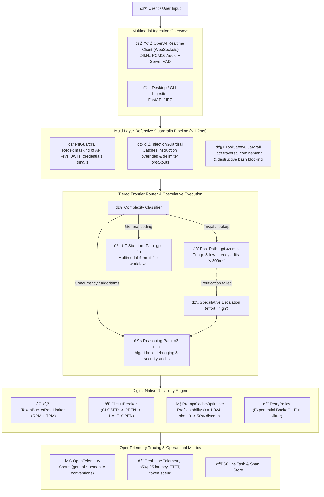

# Production AI Architecture: High-Throughput, Low-Latency Agentic Systems

> **Reference Architecture & Engineering Playbook**
> *Architected for Digital Native Scale-ups and Enterprise AI Deployments*

---

## 1. Executive Summary

This reference architecture outlines a resilient, cost-optimized, and observable production AI system built on frontier OpenAI capabilities (`o3-mini`, `gpt-4o`, `gpt-4o-mini`, and the **OpenAI Realtime API**). It addresses the four primary scaling bottlenecks faced by AI-native platforms:

1. **Latency vs. Reasoning Trade-offs:** Eliminating sluggish Time-To-First-Token (TTFT) by pairing fast-path speculative models with deep reasoning fallbacks.
2. **Rate Limit Resilience:** Protecting upstream API availability using dual-constraint token bucket limiters (RPM + TPM) and decorrelated jittered backoff.
3. **Safety & Workspace Containment:** Intercepting prompt injections, PII, and path traversal before model execution.
4. **Quantitative Confidence:** Replacing brittle string tests with statistical evaluation suites featuring 95% Wilson Score intervals and LLM-as-a-judge rubric scoring.

---

## 2. System Architecture Diagram

---

## 3. Core Architectural Modules

### 1. Ultra Low-Latency Multimodal Voice (`direct/realtime.py`)
- **Protocol:** Persistent WebSocket streaming via `wss://api.openai.com/v1/realtime?model=gpt-4o-realtime-preview`.
- **Audio Pipeline:** Bidirectional 24kHz 16-bit mono PCM streaming without transcoding overhead.
- **Server-Side VAD:** Automated turn detection with sub-400ms voice-to-voice latency.
- **Immediate Interruption:** Dispatches `response.cancel` when `input_audio_buffer.speech_started` fires, instantly halting playback on client barge-in.
- **Tool Calling:** Intercepts `response.function_call_arguments.done`, dispatches local workspace tools, and returns results back into the conversation turn.

### 2. Tiered Frontier Model Routing (`core/frontier_router.py`)
- **Fast Path (`gpt-4o-mini`):** Default for single-file modifications, linter repairs, syntax explanations, and lookups ($0.15/1\text{M}$ input tokens).
- **Reasoning Path (`o3-mini`):** Activated when prompts exhibit markers for concurrency, race conditions, memory leaks, algorithmic complexity, or security audits.
  - Parameterizes `reasoning_effort`: `low`, `medium`, `high`.
  - **CoT Prompt Sanitization:** Automatically scrubs counterproductive instructions (`"think step by step"`, `"show your thought process"`) because reasoning tokens are generated autonomously.
- **Speculative Escalation:** When a fast-path execution fails automated test verification, the diagnostic payload is speculatively re-routed to `o3-mini` with `reasoning_effort="high"`.

### 3. Concurrency Rate Limiting & Prefix Caching (`core/reliability.py`)
- **Dual Token Bucket:** Dynamically regulates both **Requests Per Minute (RPM)** and **Tokens Per Minute (TPM)** to prevent HTTP 429 errors during concurrent agent execution.
- **Full Jitter Exponential Backoff:** Randomized exponential retry intervals break synchronized waves, preventing the "thundering herd" problem against API gateways.
- **Circuit Breaker:** Trips to `OPEN` after $N$ consecutive provider failures, failing fast in $<1\text{ms}$ to allow immediate model fallback.
- **Prompt Caching Prefix Stability:** Structures system instructions and JSON tool schemas into a static prefix anchor ($\ge 1,024$ tokens), securing OpenAI’s 50% cached token discount and reducing TTFT by up to 80%.

### 4. Distributed Tracing & OpenTelemetry (`core/traces.py`)
- **OpenTelemetry GenAI Semantic Conventions:** Emits nested `agent.turn`, `llm.generate`, and `tool.execute` spans recording `gen_ai.system`, `gen_ai.request.model`, `gen_ai.usage.input_tokens`, and `gen_ai.server.time_to_first_token_s`.
- **Operational Metrics:** Computes real-time **p50, p95, and p99 latency distributions**, average TTFT, token cost, and guardrail block counts.

### 5. Multi-Layer Guardrails (`core/guardrails.py`)
- **PII & Credential Redaction:** Masks OpenAI keys, GitHub tokens, AWS keys, JWTs, and emails before logging or remote API dispatch.
- **Prompt Injection Defense:** Blocks direct instruction overrides (`"ignore all previous instructions..."`) and delimiter breakout syntax (`<system>`, `[SYSTEM]`).
- **Tool Confinement:** Enforces strict filesystem confinement preventing directory traversal (`../../`) outside the repository root and blocks catastrophic shell patterns (`rm -rf /`, `mkfs`, fork bombs).

### 6. Local-First Workspace Scoping & Deliverables (`history/store.py`, `history/api.py`)
- **Workspace Scoping:** Binds each project to a local directory path (`root_path`), ensuring coding agents execute exclusively within their designated workspace and inherit custom project guidelines.
- **Deliverable Persistence:** Automatically captures and indexes generated architecture diagrams, execution plans, source code files, and analytical reports in a relational SQLite registry.
- **Native OS Interop:** Supports low-friction opening of project workspace folders and deliverable files directly through host OS file explorers and editors.

---

## 4. Engineering Trade-Off Matrix

When architecting production AI systems for digital-native customers, choosing the correct capability pattern is critical:

| Technique | When to Choose | Cost Profile | Latency Profile | Maintenance Overhead |
| :--- | :--- | :--- | :--- | :--- |
| **Prompt Engineering + Fast Path (`gpt-4o-mini`)** | Triage, simple data extraction, syntax assistance, routine edits. | **Lowest** ($\$0.15/\text{M}$) | **Ultra Low** ($< 300\text{ms}$) | **Minimal** (Prompt updates only) |
| **Retrieval-Augmented Generation (RAG)** | Dynamic knowledge bases, large documentation repositories, real-time data. | **Low-Medium** (Embedding + retrieval) | **Medium** ($500\text{ms} - 1.2\text{s}$) | **Medium** (Index hygiene, chunk tuning) |
| **Reasoning Models (`o3-mini` / `o1`)** | Complex code refactoring, concurrency bugs, mathematical logic, security audits. | **Medium** ($\$1.10/\text{M}$) | **Higher** ($1.5\text{s} - 6.0\text{s}$ due to reasoning tokens) | **Low** (Zero manual CoT prompting required) |
| **Model Fine-Tuning** | Unique tone/style adaptation, highly specific syntax, latency reduction on fixed formats. | **High upfront** (Dataset curation + training compute) | **Fast** (Reduces prompt token overhead) | **High** (Dataset drift, version retraining) |

---

## 5. Industrial Evaluation Standards

Evaluated using `agent-standards/scripts/eval_runner.py`:
- **Deterministic Gates:** Test command exit status ($== 0$), blast radius limits, forbidden path constraints.
- **LLM-as-a-Judge (G-Eval):** Multi-dimensional rubric scoring across *Faithfulness*, *Task Completion*, *Constraint Adherence*, and *Code Quality*.
- **Statistical Significance:** Pass rates reported with **95% Wilson Score Confidence Intervals** to eliminate small-sample uncertainty.
- **A/B CI Regression Gates:** Automated pull request scorecards with `--fail-on-regression` protection.
